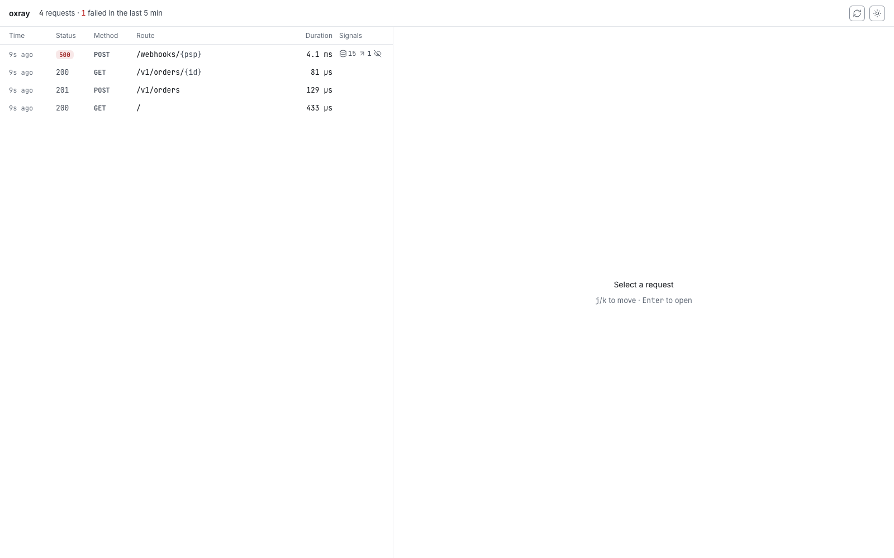
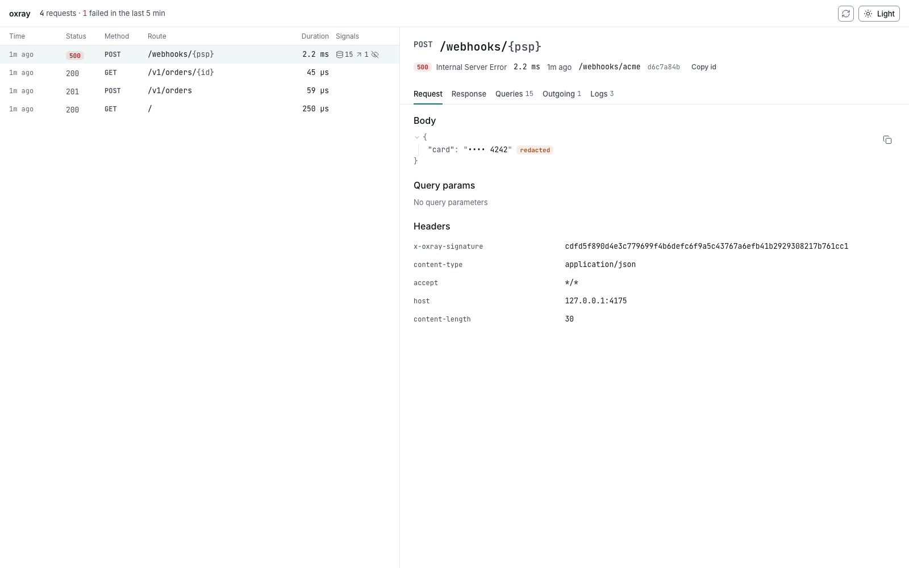
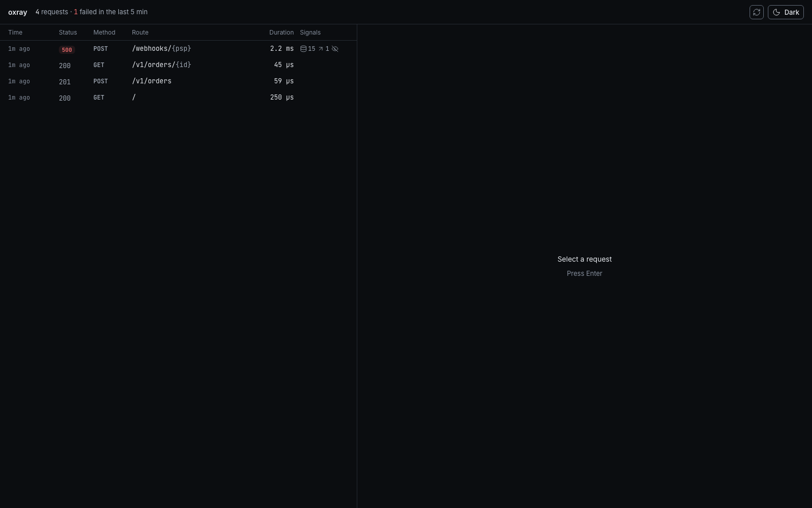
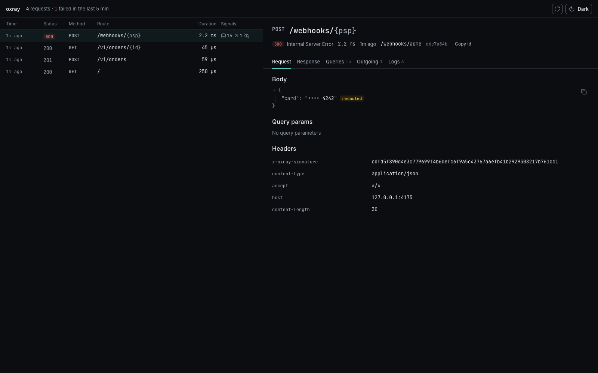

# Oxray

An X-ray for every request in your Axum app.

Oxray is a process-local request inspector. For each request it keeps the exchange, the tracing events inside that request, the sqlx queries, and the outgoing calls made with its reqwest middleware, then serves a UI and a JSON API under a mount path. It is for someone building an Axum API on their own machine, especially one that takes webhooks, talks to other services, or handles payment-like payloads. It is not an APM, and it does not run in production: a release build does not record anything.

Add it from crates.io:

```toml oxray-install
[dependencies]
axum = "0.8"
tokio = { version = "1", features = ["macros", "rt-multi-thread", "net"] }
tracing-subscriber = { version = "0.3", features = ["env-filter", "fmt", "registry"] }
oxray = "0.1"
```

Add the `reqwest` feature on `oxray`, plus `reqwest` and `reqwest-middleware`, only if you want outgoing calls recorded.

## Mount it on Axum

Build one handle and use it in three places: the tracing subscriber, the router, and the tower layer.

```rust oxray-install
.with(oxray.tracing_layer())
.merge(oxray.router())
.layer(oxray.layer());
```

```rust oxray-install
use std::io::{Write, stdout};
use std::net::SocketAddr;

use axum::Router;
use axum::routing::get;
use tracing_subscriber::prelude::*;

#[tokio::main]
async fn main() -> Result<(), Box<dyn std::error::Error>> {
    let oxray = oxray::Oxray::builder().build()?;
    tracing_subscriber::registry()
        .with(
            tracing_subscriber::fmt::layer()
                .with_filter(tracing_subscriber::EnvFilter::new("info")),
        )
        .with(oxray.tracing_layer())
        .try_init()?;
    let app = Router::new()
        .route("/", get(|| async { "ok" }))
        .merge(oxray.router())
        .layer(oxray.layer());
    let listener = tokio::net::TcpListener::bind("127.0.0.1:0").await?;
    let addr = listener.local_addr()?;
    writeln!(stdout(), "listening on http://{addr}")?;
    axum::serve(
        listener,
        app.into_make_service_with_connect_info::<SocketAddr>(),
    )
    .await?;
    Ok(())
}
```

`into_make_service_with_connect_info::<SocketAddr>()` is required. Without `ConnectInfo`, Dev mode answers 403 and names that call.

Give the fmt layer its own `EnvFilter`, as the example does. A global `RUST_LOG=info` filter would hide `sqlx::query` events. If the request span or those events are disabled, Oxray logs one warning telling you to add `oxray=trace,sqlx::query=debug`.

Outgoing calls are opt-in. With the `reqwest` feature:

```rust
let http = reqwest_middleware::ClientBuilder::new(reqwest::Client::new())
    .with(oxray.reqwest_middleware())
    .build();
```

Calls made with any other client are not recorded. The middleware attaches a call to the request that is active on that task, including a task spawned from the request.

## Dev and Disabled

`Oxray::builder().build()` picks the mode. You do not pass it in.

| Mode | When | What the mount does | What the layer does |
| --- | --- | --- | --- |
| `Dev` | A debug build, unless `OXRAY=off` | Serves the UI and the API | Records requests outside the mount |
| `Disabled` | A release build, or `OXRAY=off` in any build | Answers 404 | Lets the request through and stores nothing |

`OXRAY=off` is the only environment variable Oxray reads, and it can only turn recording off. Nothing in the environment turns a release build on. 0.1.0 has no staging opt-in.

In Dev, a request is allowed through the mount only when all of these hold:

- `ConnectInfo<SocketAddr>` is present and the peer is loopback.
- `Host` is `localhost`, `127.0.0.1`, or `[::1]`, with any port.
- `Forwarded`, `X-Forwarded-For`, and `X-Real-IP` are absent.
- If `Origin` is present, its host matches `Host`.

Anything else is 403 with a plain-text reason. A tunnel or a proxy in front of the app fails this on purpose.

## The mount

The default mount is `/_oxray`. Change it with `.mount("/debug/oxray")`. The path has to start with `/`, and it cannot be `/` or end with `/`. `build()` returns `Error::MountPath` otherwise.

Open `http://127.0.0.1:<port>/_oxray/` while the app is running. A direct link to one capture is `/_oxray/r/{id}`. The page reads `<meta name="oxray-mount">` from the HTML Oxray serves, so the same build works at another mount.

These routes live under the mount:

| Method and path | Body |
| --- | --- |
| `GET /` and `GET /r/{id}` | The UI |
| `GET /assets/*` | Hashed assets, and `theme-init.js` |
| `GET /api/captures?cursor=&limit=` | Page of summaries. `limit` is clamped to 1..=500 and defaults to 100. `failed=true`, `status=500` or `status=5xx`, and `after=<id>` narrow the page |
| `GET /api/captures/{id}` | One capture, or 404 |
| `GET /api/captures/{id}/markdown` | One capture as Markdown, or 404 |
| `GET /api/meta` | Mode, store usage, and the redaction rule names |

Oxray does not record requests to its own mount. On every other response it sets `x-oxray-id` to the capture id. `.response_header(false)` turns that header off.

The UI is a list and a detail pane. The detail tabs in 0.1.0 are Request, Response, Queries, Outgoing, and Logs. While the list is empty it polls `GET /api/captures` every 2 seconds. After the first capture it stops polling; Refresh, the `r` key, and coming back to the tab load it again. `j` / `k` move the selection, Enter opens it, Esc returns to the list when the width is a single column, and `t` cycles the theme. The choice is stored in `localStorage['oxray.theme']`.

## What a capture holds

One capture is one request:

- Method, concrete path, and the Axum route template when `MatchedPath` is set. A request that matched no route keeps the concrete path.
- Status and duration. A handler that panics before writing a response can leave status empty. 0.1.0 does not record a panic location.
- Request and response headers, query string, and bodies. Each body is kept up to `body_limit` (64 KiB). Past that, the capture is marked truncated.
- Tracing events emitted while the `oxray.request` span is active: level, target, message, and fields.
- sqlx queries from `sqlx::query` events: the statement and the duration. They are listed one by one. The default fingerprint treats three identical statements as N+1 (`.n_plus_one_threshold`), but 0.1.0 does not group them in the UI.
- Outgoing HTTP from `reqwest_middleware()`, when that feature is on: method, URL, status, duration, headers, and bodies.

The store is in memory. It keeps at most 1,000 captures and 64 MiB (`.max_captures`, `.max_bytes`). Restarting the process drops them. `.body_limit`, `.max_captures`, and `.max_bytes` reject zero.

If the store or the redactor fails, Oxray discards that capture, logs one warning per failure kind, and does not fail the application request.

## Redaction

Redaction runs before the capture is stored. The stored bytes are what the UI and `GET /api/captures/{id}` return.

By default, header values are replaced with `[redacted]` for `authorization`, `proxy-authorization`, `cookie`, `set-cookie`, `x-api-key`, and `x-auth-token`. JSON object keys are redacted when they normalize to `pin`, `cvv`, `cvc`, `cvv2`, `otp`, or `pan`, or when the normalized key contains `password`, `passwd`, `secret`, `token`, `apikey`, `privatekey`, `cardnumber`, or `authorization`. A PAN that passes Luhn, including one written with spaces or hyphens, and a valid 18-digit CLABE, are masked as `••••` plus the last four digits wherever they appear in text Oxray stores: bodies, paths, query strings, headers, log fields, SQL, and outgoing URLs. `.redact_headers` and `.redact_keys` add names. They do not remove the defaults.

The UI shows the masked text and a `redacted` chip. The clear value is not kept beside it.

## Demo

`examples/demo` is an Axum app wired the same way. `GET /` answers `ok`. `POST /v1/orders` records a paid order and `GET /v1/orders/{id}` reads it back. `POST /webhooks/{psp}` checks an HMAC-SHA256 signature, runs sqlx (one statement repeated 14 times), calls a fake processor on another port, and answers 500 with `processor failed`. The webhook body carries the test card `4242 4242 4242 4242`, which Oxray stores as `•••• 4242`. `POST /corpus` is the redaction fixture, not part of the walkthrough.

From a checkout:

```sh
cargo run -p demo -- serve --port 4175
cargo xtask seed --url http://127.0.0.1:4175
```

`seed` sends fixed requests. The newest row is `POST /webhooks/{psp}`. Open <http://127.0.0.1:4175/_oxray/>.









[Keyboard walkthrough of that webhook](assets/readme/f1-light.webm)

`serve --mount /debug/oxray` moves the UI. The demo's default mount is `/_oxray`.

## With a coding agent

Every response carries an `x-oxray-id` header, and `GET {mount}/api/captures/{id}/markdown` returns that exchange as a compact Markdown document. `GET {mount}/api/captures?failed=true&limit=10` lists recent failures; `status=5xx` and `after=<id>` narrow the list too. In tests, `oxray.capture(&id)` or `oxray.latest_capture()` returns the stored `Capture`, so a failing assert can print `capture.markdown()`.

Paste this into the app's `AGENTS.md` or `CLAUDE.md`:

```text
Oxray in Dev builds records every request this app serves; UI/API: http://127.0.0.1:3000/_oxray.
Every response carries an x-oxray-id header.
Its capture as Markdown: http://127.0.0.1:3000/_oxray/api/captures/{id}/markdown
Recent failures: http://127.0.0.1:3000/_oxray/api/captures?failed=true&limit=10
The list also takes status=5xx and after=<id>.
In tests: oxray.capture(&id) or oxray.latest_capture(), print capture.markdown() in asserts.
```

```rust
let response = app.clone().oneshot(request).await?;
let status = response.status();
let id = response.headers().get("x-oxray-id").unwrap().to_str()?.to_owned();
let _body = axum::body::to_bytes(response.into_body(), usize::MAX).await?; // the capture is stored once the body is read
let capture = oxray.capture(&id).unwrap();
assert_eq!(status, StatusCode::OK, "{}", capture.markdown());
```

## What 0.1.0 does not do

No persistence across restarts, no live updates, no search, no staging mode, no MCP, no panic backtrace, no "copy as cURL" or copy-as-Markdown button, and no N+1 grouping in the list. Those are outside this version.

## Development

Rust 1.96.0 comes from `rust-toolchain.toml`. Node is 24. Visual checks need Docker.

```sh
cargo xtask verify
```

`oxray::format_duration` renders a `std::time::Duration` the way the UI does: `74 µs`, `1.2 ms`, `812 ms`, `1.24 s`, `1 min 4 s`.

## License

MIT OR Apache-2.0, at your option.
